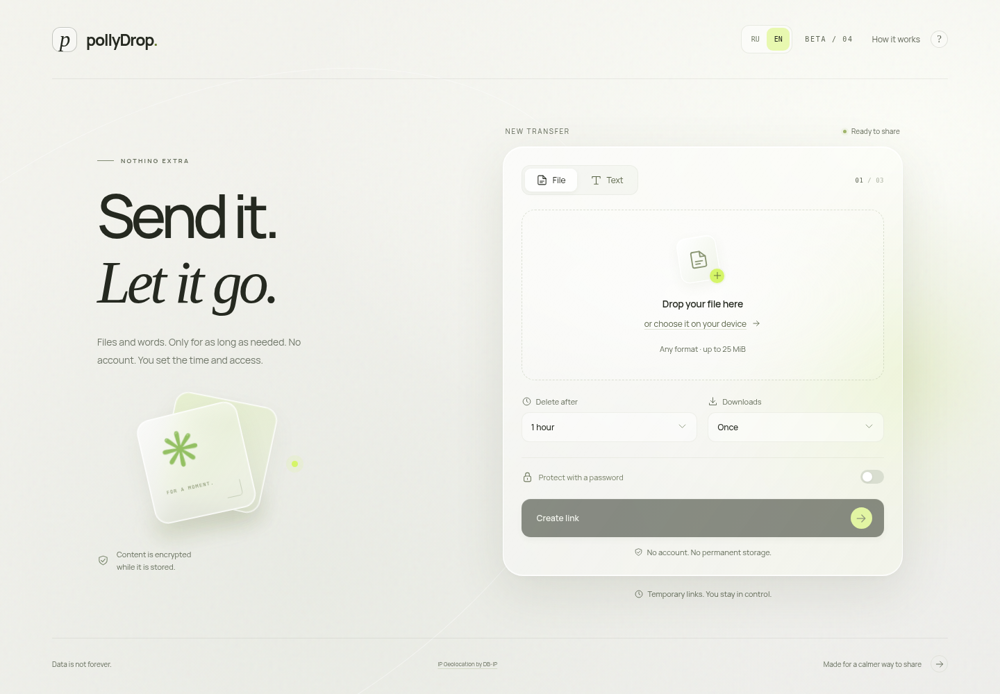
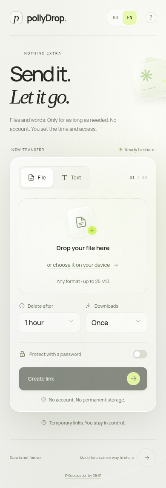

<p align="center"></p>

<p align="center"><a href="../../README.md">Русский</a> · <b>English</b></p>
<p align="center"><a href="https://drop.pollybich.ru">Open the site</a> · <a href="https://github.com/pollybich/pollyDrop/releases">Releases</a> · <a href="ROADMAP.md">Roadmap</a> · <a href="REQUIREMENTS.md">Requirements</a></p>

#  pollyDrop

Temporary file and text transfers without registration. Set a lifetime, a download limit and an optional password, then share the recipient link. A separate secret management link lets you check the status and revoke access.

**Current beta: v0.1.0-beta.4.** React + TypeScript, Java 21 + Spring Boot, PostgreSQL and Docker. A responsive light interface with frosted glass, editorial typography and subtle motion, respecting reduced-motion preferences.

## ✳ Interface

<p align="center"></p>
<details>
<summary>See the mobile interface</summary>

<p align="center"></p>
</details>

| Send | Set the limits | Let it go |
| --- | --- | --- |
| A file or text, without an account | Lifetime, download count, password | Content deleted on expiry or the final download |

## ◇ Available today

- Files up to 25 MiB; UTF-8 text up to 64 KiB.
- Russian/English interfaces, RU / EN switch, country-based initial choice and remembered manual preference.
- Lifetime: 10 minutes, 1 hour, 24 hours or 2 days. The current source defaults to **1 hour**.
- 1, 3, 5 or 10 successful server-side deliveries.
- Optional password, separate management link and revocation.
- One active delivery per transfer; a detected interruption releases the reservation for retry.
- AES-256-GCM content encryption, Argon2id passwords and hashed access tokens.
- Content deletion after the final delivery or revocation; expiry timers, one-second cleanup retries and recovery after restart.

Opening a recipient page does not consume a download. The server counts a completed send, not a saved file on the device. If the browser fails after the server finishes, the consumed download is not restored. Recipients can keep or forward their copies.

Files use native HTTP attachment downloads. Chrome saves automatically when “Ask where to save each file” is disabled in `chrome://settings/downloads`. Messenger browsers may restrict downloads; iPhone Telegram links can be opened in Safari.

With a 10-minute lifetime and 3 downloads, content is removed when either the timer expires or the third delivery finishes, whichever happens first. Preparing a ticket, viewing conditions and HEAD requests do not spend a download. Migration shortens older transfers to at most two days from creation.

## ↗ Quick start with Docker

Requires Docker Engine with Compose, Bash and Python 3.

```bash
git clone https://github.com/pollybich/pollyDrop.git
cd pollyDrop
./scripts/init-env.sh
python3 scripts/prepare-geoip.py
docker compose up --build -d
```

The interface listens on loopback port **8088**. PostgreSQL is not exposed. Configure a domain, HTTPS and a reverse proxy for external access.

`.env` is generated once with random secrets, excluded from Git and preserved on reruns. Keep the original encryption key with your database/content backups: replacing `APP_MASTER_KEY` makes existing transfers unreadable. Never include `.env` in a bug report.

```bash
docker compose logs backend
docker compose down
```

`down` preserves volumes. Do not add `-v` if you need the data.

## Debian server updates

```bash
cd /opt/pollydrop
git pull --ff-only
./deploy/server/update-debian.sh
```

The script preserves secrets and volumes, downloads the SHA-256-verified released backend and installs the **prebuilt frontend from the release**. A normal update therefore applies the one-hour default without an extra flag or a new version. Docker handles Node.js compilation; no host Node.js is required. Caddy reloads with HTTP/1.1 and HTTP/2. See [deployment](DEPLOYMENT.md).

If the old 24-hour interface persists, run `./deploy/server/update-interface.sh` to apply a checked prebuilt snapshot without Node.js compilation and verify the served JavaScript.

`--frontend-from-source` remains compatible. The released frontend is the default; `--frontend-from-source` explicitly compiles the checkout.

## Resumable transfers

File uploads are encrypted in 1 MiB parts. Browser storage retains only a capability, file fingerprint, settings and acknowledged offset, never file contents or the plaintext password. Select the same file after reopening the page; SHA-256 validates its contents before continuing. Server progress survives a backend restart. Browser storage must remain available; clearing it removes local recovery details.

The original retention deadline begins when the upload session is created and never moves on retry. Abandoned encrypted parts expire too. File size remains limited to 25 MiB.

Native downloads support a single HTTP Range and a stable ETag. Partial responses and retries within one unfinished download session consume one allowance only after complete server delivery. HEAD consumes none. Download-manager resume support varies by browser; a full HTTP 200 restarts safely if the requested offset cannot be confirmed. Once the server has completed its delivery and erased the last permitted copy, a later browser/proxy failure cannot recover that copy. The server cannot verify that a device saved the file.

## Development

Requires a **full JDK 21** with `javac`, Node.js 24, Docker Compose and Python 3. Bootstrap downloads Maven 3.9.11 with SHA-512 verification if needed.

```bash
./scripts/bootstrap-dev.sh
./scripts/backend.sh
```

In another terminal:

```bash
npm --prefix frontend run dev
```

Vite runs on port 5173 and proxies `/api` to backend:8080. Development uses a separate `pollydrop-dev` database on loopback:5432 and `data/files`; the Docker installation uses its own volumes. Do not mix metadata and content from different installations. One backend per database is enforced with a PostgreSQL advisory lock.

```bash
./scripts/backend.sh test
npm --prefix frontend run build
```

Integration tests use a separate Testcontainers database. See [testing](TESTING.md) for browser checks.

## Beta boundaries

Accounts, an account dashboard, advertising and corporate administration are planned. Guest transfer management already works through a secret link.

Country lookup uses a bundled [DB-IP Lite](https://db-ip.com) database without sending visitor IPs to an external service. Russian is selected for Russia; English for other or unknown countries. Manual choice takes priority. The [CC BY 4.0 license](../../licenses/DBIP-LICENSE.txt), source and checksum are recorded in [configuration](../../config/geoip-source.json).

Encryption happens on the server; this is **not end-to-end encryption**. Metadata remains after content deletion. Backup retention is the administrator’s responsibility. Password rate limits are in memory, reset on restart and use the direct connection IP; proxy users may share it.

The beta uses one backend and local encrypted storage with a default 1 GiB quota. Public use needs further abuse protection, load testing and security review. Configuration: [environment example](../../.env.example).

## Documentation

| Section | Contents |
| --- | --- |
| [Roadmap](ROADMAP.md) | Completed work and next steps |
| [Requirements](REQUIREMENTS.md) | Features and acceptance criteria |
| [Architecture](ARCHITECTURE.md) | API, delivery and storage |
| [Testing](TESTING.md) | Builds and browser scenarios |
| [Deployment](DEPLOYMENT.md) | Debian, HTTPS and updates |
| [Releasing](RELEASING.md) | Publication workflow |

---

Data is not forever. Made for a calmer way to share.
